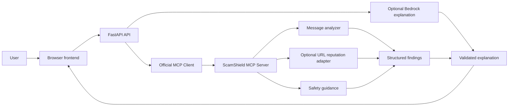

# ScamShield AI

ScamShield AI is an open-source Python safety assistant for investigating
potential scams, phishing messages, suspicious job offers, impersonation, and
URLs that need further checking. It returns explainable warning indicators and
practical next steps. It does **not** prove that content is fraudulent and
never treats an inconclusive or unavailable lookup as proof that content is
safe.

This repository contains a reusable analysis package, an official Python MCP
server, a FastAPI integration, an optional Amazon Bedrock explanation service,
and a small browser frontend.

## Status and scope

This is an early-stage project intended for development, learning, and
hackathon-scale deployments. It is not a replacement for a bank, security
team, law-enforcement agency, or professional incident-response service.

The local analyzer uses deterministic rules. It can identify observable
patterns such as requests for money or credentials, urgency, prize claims,
suspicious job language, impersonation cues, and URLs. Rule matches are
preliminary indicators and can produce false positives or miss scams.

## Architecture



The MCP server can run locally over stdio, locally over Streamable HTTP, or
behind a separately secured remote deployment. The default FastAPI path uses
the official MCP client against the local MCP server object; it does not call
the analyzer directly while claiming to be an MCP workflow.

## Features

- Framework-independent message analysis with typed dataclasses.
- Structured findings containing indicator type, supporting text, explanation,
  relative severity, and a recommended verification step.
- Conservative `suspicious` and `inconclusive` message statuses; there is no
  `safe` status.
- Redaction of likely OTPs, passwords, PINs, CVVs, and numeric secrets in
  returned evidence excerpts.
- MCP tools for message analysis, URL reputation, and safety guidance.
- URL validation that rejects unsupported schemes, embedded credentials,
  control characters, and private or local destinations.
- No URL visiting, rendering, downloading, execution, or redirect following.
- Optional Google Safe Browsing lookup integration. It is disabled by default.
- Optional Amazon Bedrock explanation generation with strict Pydantic
  validation. It cannot add tool findings or invent verification results.
- FastAPI health, readiness, investigation, and follow-up endpoints.
- Vanilla HTML/CSS/JavaScript frontend with accessible error and loading states.
- Tests using mocked external services.

## Requirements

- Python 3.11 or newer.
- Node.js is only needed if you use the MCP Inspector.
- AWS credentials are only needed for live Bedrock use.
- A Safe Browsing API key is only needed for live URL reputation lookups.

## Installation

From a fresh clone:

```bash
cd scamshield-ai
python3.11 -m venv .venv
source .venv/bin/activate
python -m pip install --upgrade pip
python -m pip install -e ".[test]"
```

Copy the configuration template if you need optional integrations:

```bash
cp .env.example .env
```

The application does not automatically load `.env`; export variables in your
shell or use the environment-loading mechanism of your deployment. Never
commit `.env`.

## Minimal Python example

The deterministic analyzer does not require a network connection, API key, or
AWS account:

```python
from scamshield import analyze_message

result = analyze_message(
    "Your account will be blocked today. Pay a processing fee and reply with your OTP."
)

print(result.to_dict())
```

Typical shape:

```json
{
  "status": "suspicious",
  "findings": [
    {
      "indicator_type": "upfront_payment",
      "supporting_text": "Pay a processing fee",
      "explanation": "The message asks for money or a payment before a promised service, benefit, or resolution.",
      "severity": "high",
      "recommended_verification": "Verify the request through an official website or a trusted phone number; do not pay using instructions in the message."
    }
  ],
  "limitations": [
    "These are preliminary indicators, not proof that the message is fraudulent.",
    "An inconclusive result does not mean the message is safe."
  ],
  "message_length": 83
}
```

Inputs must be non-empty strings no longer than 10,000 characters by default.
The analyzer does not store submitted messages.

## MCP server

Run the local stdio server:

```bash
python -m scamshield.mcp_server
```

Stdio is intended for an MCP host or the Inspector. Application logs must not
be written to stdout because stdout is the protocol channel.

### Tool response envelope

Every tool returns one of these JSON-compatible structures:

```json
{"ok": true, "result": {}}
```

```json
{"ok": false, "error": {"code": "invalid_input", "message": "..." }}
```

Errors are sanitized and do not include API keys, credentials, or raw
provider failures.

### `analyze_message`

Purpose: find preliminary warning indicators in a message.

Arguments:

```json
{"message": "string, required, 1-10000 characters"}
```

Successful result:

```json
{
  "ok": true,
  "result": {
    "status": "suspicious | inconclusive",
    "findings": [
      {
        "indicator_type": "upfront_payment | credential_request | urgency_threat | prize_reward | suspicious_job_offer | impersonation | url_for_investigation",
        "supporting_text": "redacted evidence excerpt",
        "explanation": "plain-language explanation",
        "severity": "low | medium | high",
        "recommended_verification": "independent verification step"
      }
    ],
    "limitations": ["string"],
    "message_length": 83
  }
}
```

The tool observes message text only. It does not authenticate senders,
confirm organizations, open links, or prove fraud.

### `check_url_reputation`

Purpose: validate a URL and optionally submit it to the configured reputation
provider. The service never requests the URL itself.

Arguments:

```json
{"url": "http or https URL, required, max 2048 characters"}
```

Successful result:

```json
{
  "ok": true,
  "result": {
    "status": "malicious | no_threat_found | unknown | lookup_failed",
    "url": "sanitized URL",
    "domain": "example.com",
    "provider": "google_safe_browsing or null",
    "details": "provider or configuration explanation",
    "limitations": ["string"],
    "evidence": [
      {
        "threatType": "provider field when supplied",
        "platformType": "provider field when supplied"
      }
    ]
  }
}
```

`malicious` means the configured provider reported a threat match. It is a
provider signal, not a complete security assessment. `no_threat_found` means
only that no matching threat was returned at lookup time; it is not a safe
verdict. `unknown` means no provider is configured. `lookup_failed` covers
timeouts, rate limits, authentication failures, outages, and unusable
responses.

### `get_safety_guidance`

Purpose: return practical next steps for a common situation.

Arguments:

```json
{"category": "suspicious_job_offer | phishing_message | suspected_account_compromise | money_already_sent"}
```

Successful result:

```json
{
  "ok": true,
  "result": {
    "category": "phishing_message",
    "immediate_steps": ["string"],
    "avoid": ["string"],
    "if_already_acted": ["string"],
    "limitations": ["string"]
  }
}
```

The guidance is general information. It cannot recover funds, verify an
identity, or replace the affected provider's official support process.

## Optional integrations

### Amazon Bedrock

Bedrock is explanation-only. The service receives the original message after
likely secret redaction and structured tool findings. The model must return
validated JSON containing:

- `assessment`
- `supporting_warning_signs`
- `observed_evidence`
- `inferences`
- `missing_information`
- `recommended_next_steps`
- `uncertainty_explanation`

Configure only with values available in your AWS account:

```bash
export AWS_REGION=your-region
export SCAMSHIELD_BEDROCK_MODEL_ID=your-model-or-inference-profile
```

Use an AWS CLI profile locally or an IAM role in AWS. The application role
needs the least privilege required for the selected model, normally
`bedrock:InvokeModel`; restrict the resource in production where supported.
Model availability and access approval vary by region and model. Check the
current AWS documentation and account console before selecting an ID.

Mocked tests do not call AWS and do not incur charges. Live calls require
credentials, model access, and may incur charges. Configure token limits,
budgets, CloudWatch alarms, and Cost Explorer before public deployment.

### URL reputation

The current optional adapter is Google Safe Browsing Lookup API v4. It is
documented for non-commercial use, uses project quotas, and requires qualified
warnings and Google attribution for Google-derived findings. The provider
receives only the normalized scheme, host, and optional port for this MVP, not
the full message or URL path. Query parameters, fragments, and path values
are removed before the provider request because they can contain identifiers or
bearer tokens.

```bash
export SCAMSHIELD_SAFE_BROWSING_API_KEY=your-provider-key
```

Without this variable, the result is `unknown` and no provider request is
made. For a commercial service, review Google's current terms and consider a
commercial product such as Web Risk or another provider whose terms fit the
deployment. Provider terms, pricing, and quotas can change; verify them
before release.

### Remote MCP

Set `SCAMSHIELD_MCP_URL` only when connecting the FastAPI layer to a deployed
Streamable HTTP MCP endpoint:

```bash
export SCAMSHIELD_MCP_URL=https://your-host.example/mcp
```

A local `127.0.0.1` endpoint is not remotely accessible. A public deployment
needs HTTPS, authentication and authorization, origin validation,
DNS-rebinding protection, rate limits, secret storage, monitoring, and
provider-specific request controls.

## FastAPI and browser application

### Container image

The repository includes a minimal container image for the FastAPI service:

```bash
docker build -t scamshield-api .
docker run --rm -p 8000:8000 \
  -e AWS_REGION=your-region \
  -e SCAMSHIELD_BEDROCK_MODEL_ID=your-model-id \
  scamshield-api
```

The same image can run the optional remote MCP service by overriding its
command:

```bash
docker run --rm -p 8001:8000 \
  -e PORT=8000 \
  scamshield-api \
  python -m scamshield.mcp_http
```

The MCP HTTP entrypoint only supplies the transport. It does not provide
authentication. A public MCP deployment must place it behind an authenticated
gateway or add an MCP-compatible OAuth/authentication layer before exposing
it to external clients.

Run the API:

```bash
uvicorn scamshield.api:app --reload --port 8000
```

Run the static frontend in another terminal:

```bash
python -m http.server 4173
```

Open `http://127.0.0.1:4173`.

Available API endpoints include:

```text
GET  /health
GET  /ready
POST /api/investigate
POST /api/follow-up
```

The browser never receives AWS credentials or provider keys. Backend failures
are shown as errors; the frontend does not manufacture successful results.

For a public deployment, configure `SCAMSHIELD_API_KEY` and require the
frontend or trusted gateway to send it as `X-ScamShield-API-Key`. The API also
has a simple per-process request limit controlled by
`SCAMSHIELD_RATE_LIMIT_PER_MINUTE` (default 30). Use an authenticated,
distributed gateway or load balancer for production-scale rate limiting,
quotas, and abuse prevention. Follow-up requests use a process-signed token
issued by a successful investigation rather than accepting arbitrary
client-supplied findings. Tokens expire after
`SCAMSHIELD_FOLLOW_UP_TOKEN_TTL_SECONDS` seconds (900 by default). Set
`SCAMSHIELD_SESSION_SIGNING_KEY` to a stable random secret when running
multiple processes.

## MCP Inspector

With Node.js/npm available:

```bash
uv run --with "mcp[cli]" --with-editable . mcp dev scamshield/mcp_server.py
```

Or after installation:

```bash
mcp dev scamshield/mcp_server.py
```

The Inspector starts the local server over stdio. It does not make the server
internet-accessible. For local Streamable HTTP testing:

```bash
python -m scamshield.mcp_http
```

The endpoint is `http://127.0.0.1:8000/mcp`. Verify discovery and a real tool
call with the official MCP client:

```bash
python - <<'PY'
import asyncio
from mcp import Client

async def main():
    async with Client("http://127.0.0.1:8000/mcp") as client:
        tools = await client.list_tools()
        print([tool.name for tool in tools.tools])
        result = await client.call_tool(
            "analyze_message",
            {"message": "Your account will be blocked today. Pay a fee."},
        )
        print(result.structured_content)

asyncio.run(main())
PY
```

The HTTP entrypoint has no authentication by itself; never expose it publicly
without an authenticated HTTPS gateway.

## Tests and security audit

Run the complete local suite:

```bash
python3.11 -m venv .venv
source .venv/bin/activate
python -m pip install -e ".[test]"
python -m pytest
```

Run focused tests:

```bash
python -m pytest tests/test_message_analyzer.py
python -m pytest tests/test_reputation_provider.py
python -m pytest tests/test_bedrock_service.py
python -m pytest tests/test_mcp_integration.py
```

The ordinary tests use mocks and do not require AWS credentials, live provider
keys, or internet access. The MCP SDK and integration tests require the
supported Python 3.11+ environment. No live cloud-provider result should be
inferred from a passing mocked test.

Audit installed dependencies with `pip-audit`:

```bash
python -m pip install pip-audit
pip-audit
```

The local editable `scamshield-ai` package is not published on PyPI, so
`pip-audit` cannot audit that local package by package-index lookup. This does
not replace source review or a CI dependency audit.

### Optional live Bedrock smoke test

This makes one real Bedrock request and may incur charges:

```bash
export AWS_REGION=your-region
export SCAMSHIELD_BEDROCK_MODEL_ID=your-approved-model-id
python scripts/bedrock_smoke_test.py
```

The script uses synthetic content, validates the normal Pydantic response
schema, and prints only response-shape information. It is not part of the
ordinary test suite.

## Examples

The `examples/` directory contains synthetic JSON only:

- `suspicious_message.json`: a message with pressure, credential, and URL
  indicators.
- `ambiguous_message.json`: a benign-looking message that still requires
  independent verification.
- `mcp_tool_calls.json`: example argument objects for all three MCP tools.

Do not add real messages, phone numbers, account identifiers, API keys, or
private URLs to examples or tests.

## Privacy and security

- Do not submit passwords, OTPs, PINs, CVVs, card numbers, recovery codes, or
  other secrets.
- Submitted content is processed in memory and is not persisted by default.
- Avoid logging raw messages, URLs with query values, credentials, or provider
  responses.
- The optional Bedrock integration sends submitted content to AWS after
  redaction according to the configured service behavior and AWS terms.
- The optional reputation integration sends the sanitized URL to its provider.
- URLs are never opened or downloaded by ScamShield.
- No result is a guarantee of safety or fraud detection.
- If an account or payment is at risk, use the affected organization's
  independently located official support channel immediately.

Report security vulnerabilities privately to the project maintainers rather
than publishing exploit details in an issue. Include a minimal reproduction
with secrets and personal data removed.

## Contributing

See [CONTRIBUTING.md](CONTRIBUTING.md) for setup, testing, security, and pull
request expectations. Community participation follows
[CODE_OF_CONDUCT.md](CODE_OF_CONDUCT.md).

## License

ScamShield AI is released under the MIT License. See [LICENSE](LICENSE).
